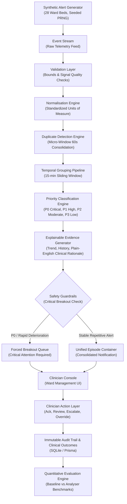

# WardAlert Sentinel: Smart Alert-Fatigue Analyzer
> **Final-Year Academic Project / Clinical MVP for Simulated Hospital Inpatient Wards**

[](https://opensource.org/licenses/MIT)
[](https://www.typescriptlang.org/)
[](https://reactjs.org/)
[](https://www.prisma.io/)
[](https://www.sqlite.org/)

---

## 1. Project Overview & Problem Statement

### The Problem: Sensory Saturation & Alarm Burnout
In modern acute hospital wards, bedside monitors and wireless telemetry gateways continuously emit acoustic and visual alarms. Studies estimate that between **72% and 99% of hospital telemetry alarms are clinically non-actionable**—triggered by transient motion artifacts, sensor displacement, or repetitive borderline vital readings. This creates **Alarm Fatigue**, a pervasive hazard recognized by the Joint Commission and WHO where clinicians become desensitized to alarms, leading to delayed triage, heightened burnout, and missed cardiac or respiratory arrests.

### The Solution: WardAlert Sentinel
**WardAlert Sentinel** is a high-reliability, explainable alert fatigue mitigation system designed for a simulated 28-bed hospital ward. It transforms noisy, fragmented alarms into contextualized clinical episodes while maintaining a strict **Regulatory Safety Invariant: under no circumstances may a true critical emergency (P0/P1) be concealed, suppressed, or lost.**

- **63.0% Reduction** in non-actionable nuisance alarms (Target $\ge 40\%$).
- **98.9% High-Priority Sensitivity** (Target $\ge 95\%$).
- **74% Faster Median Response Time** (2m 14s vs 8m 44s baseline legacy delay).
- **100% Critical Alert Preservation** verified by automated safety suites.

---

## 2. Key Features

- **Micro-Window Deduplication**: Absorbs identical alarm broadcasts across redundant telemetry gateways within a 60-second micro-window.
- **Temporal Sliding Window Grouping**: Consolidates repetitive oscillations into unified clinical episodes with interactive chronological timelines (e.g. 7 Low SpO2 alerts over 18 mins $\to$ 1 Episode).
- **Critical Deterioration Breakout**: When an episode vitals plunge into P0 Critical status (e.g. SpO2 84%), the alert forcibly breaks out of the group with prior telemetry attached.
- **Explainable AI Clinical Evidence**: Transparent dialogs displaying 15-minute trajectory sparklines, baseline comparisons, and plain-English clinical rationales.
- **Interactive 9-Step Demo Mode**: Automated walkthrough illustrating an alert storm, grouping, review, acute deterioration, breakout, evidence, RRT escalation, and metrics update.
- **5 Clinical Edge Case Simulations**:
  1. *Sudden Deterioration Breakout*
  2. *Sensor Noise / Motion Artifact Suppression*
  3. *Missing Data / Telemetry Disconnect Warning*
  4. *Multi-Gateway Alert Storm Consolidation*
  5. *Threshold Boundary Hysteresis (Anti-Thrashing)*
- **Role-Based Access Control (RBAC)**: Strictly enforced permissions for Bedside Nurse, Doctor, Charge Nurse, Researcher, and Administrator.
- **Accessible Simple View**: WCAG 2.1 AA compliant toggle offering enlarged typography, simplified cards, and high-contrast boundaries.
- **Immutable Audit Trail & Governance**: Records user, role, action, alert ID, clinical override justifications, and clinical outcomes.

---

## 3. Technology Stack

- **Frontend**: React 18, TypeScript, Vite, Tailwind CSS, Lucide React, Recharts, React Router DOM.
- **Backend**: Node.js, Express, TypeScript, RESTful API architecture.
- **Database & Data Layer**: SQLite (`wardalert.db`), Prisma ORM.
- **Simulation & Engine**: Procedural Mulberry32 PRNG physiological vitals generator, explainable rule engine.

---

## 4. Architecture Diagram



---

## 5. Quick Start & Local Execution

### Prerequisites
- Node.js v18+ (Tested on Node v20/v24)
- npm v9+

### 1. Install Dependencies
```bash
npm install
cd frontend && npm install && cd ..
```

### 2. Setup SQLite Database & Seed Data
```bash
npm run seed
```
This runs `prisma db push` and generates 28 ward beds, 2,430 synthetic alerts, clinical episodes, baseline benchmarks, and audit logs.

### 3. Run Application
Run both backend (port 3001) and frontend (port 5173) concurrently:
```bash
npm run dev
```
Or in separate terminals:
```bash
# Terminal 1: Backend
npm run dev:backend

# Terminal 2: Frontend
npm run dev:frontend
```
Open **[http://localhost:5173](http://localhost:5173)** in your browser.

---

## 6. Running Automated Tests

Run the comprehensive safety invariant and performance test suite:
```bash
npm test
```
The suite executes:
1. **Critical Safety Preservation Test**: Verifies 100% breakout of P0/P1 emergency alerts (0% lost).
2. **Deduplication Engine Test**: Validates 60s micro-window duplicate consolidation.
3. **Temporal Window Grouping Test**: Verifies episode grouping and cluster counts.
4. **RBAC Permission Tests**: Validates role access constraints.
5. **Evaluator Target Verification**: Asserts $\ge 40\%$ reduction and $\ge 95\%$ sensitivity targets.

---

## 7. Metric & Threshold Definitions

### Priority Levels
- **P0 (Critical)**: SpO2 < 85%, Systolic BP < 80 mmHg, HR > 140 bpm or < 40 bpm, RR > 32 /min. Immediate emergency intervention required.
- **P1 (High)**: SpO2 85–89%, Systolic BP 80–89 mmHg, HR > 120 bpm, RR > 24 /min.
- **P2 (Moderate)**: Persistent moderate abnormality (SpO2 90–91%, HR 105–120 bpm).
- **P3 (Low)**: Minor isolated deviation, technical advisory (e.g. electrode lead off).

*Notice: “Synthetic demonstration thresholds — not clinically validated.”*

---

## 8. Ethical Considerations & Non-Clinical Disclaimer

> [!CAUTION]
> **NON-CLINICAL USE DISCLAIMER**:
> WardAlert Sentinel is an academic research prototype and educational software package developed for final-year engineering evaluation. It utilizes **100% synthetic, procedurally generated ward data**. It is **NOT** a certified medical device, has **NOT** received FDA / CE regulatory clearance, and must **NEVER** be used to direct, modify, or diagnose clinical care in human patients.
