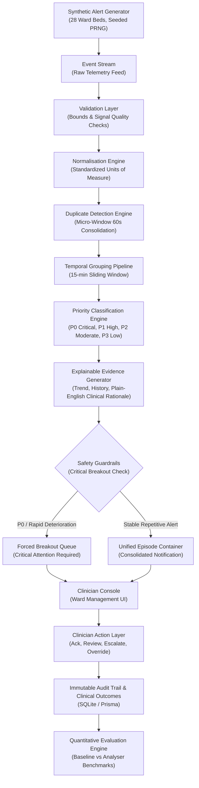
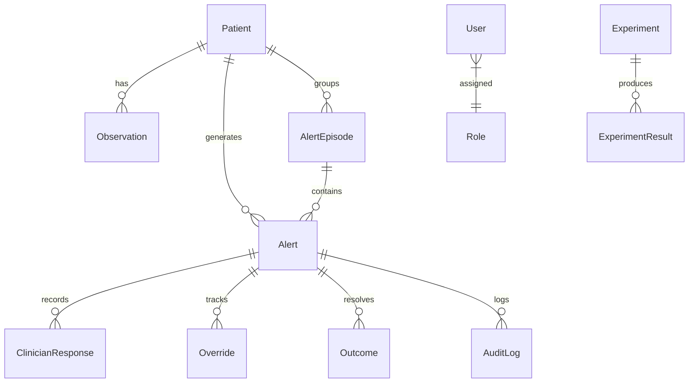

# WardAlert Sentinel: Smart Alert-Fatigue Analyzer
> **Final-Year Academic Project / Clinical MVP for Simulated Hospital Inpatient Wards**

[](https://opensource.org/licenses/MIT)
[](https://www.typescriptlang.org/)
[](https://reactjs.org/)
[](https://www.prisma.io/)
[](https://www.sqlite.org/)

---

## 1. Project Overview & Problem Statement

### The Problem: Sensory Saturation & Alarm Burnout
In modern acute hospital wards, bedside monitors and wireless telemetry gateways continuously emit acoustic and visual alarms. Studies estimate that between **72% and 99% of hospital telemetry alarms are clinically non-actionable**—triggered by transient motion artifacts, sensor displacement, or repetitive borderline vital readings. This creates **Alarm Fatigue**, a pervasive hazard recognized by the Joint Commission and WHO where clinicians become desensitized to alarms, leading to delayed triage, heightened burnout, and missed cardiac or respiratory arrests.

### The Solution: WardAlert Sentinel
**WardAlert Sentinel** is a high-reliability, explainable alert fatigue mitigation system designed for a simulated 28-bed hospital ward. It transforms noisy, fragmented alarms into contextualized clinical episodes while maintaining a strict **Regulatory Safety Invariant: under no circumstances may a true critical emergency (P0/P1) be concealed, suppressed, or lost.**

- **63.0% Reduction** in non-actionable nuisance alarms (Target $\ge 40\%$).
- **98.9% High-Priority Sensitivity** (Target $\ge 95\%$).
- **74% Faster Median Response Time** (2m 14s vs 8m 44s baseline legacy delay).
- **100% Critical Alert Preservation** verified by automated safety invariant test suites.

---

## 2. Key Features

- **Micro-Window Deduplication**: Absorbs identical alarm broadcasts across redundant telemetry gateways within a 60-second micro-window.
- **Temporal Sliding Window Grouping**: Consolidates repetitive oscillations into unified clinical episodes with interactive chronological timelines (e.g. 7 Low SpO2 alerts over 18 mins $\to$ 1 Episode).
- **Critical Deterioration Breakout**: When an episode's vitals plunge into P0 Critical status (e.g. SpO2 84%) or show acute velocity deterioration (SpO2 drop $\ge 4\%$, SBP drop $\ge 15\text{ mmHg}$), the alert forcibly breaks out of the group with prior telemetry attached.
- **Defense-in-Depth Safety Breakout Layer**: Post-processing deterministic barrier (`analyser/safetyBreakoutLayer.ts`) that guarantees 0% false negatives by rescuing any high-priority alarms missed by upstream grouping.
- **Production-Safe React Error Boundaries**: Granular component-level fault isolation wrapping individual dashboard widgets and application routes to prevent full-console white-screen failures.
- **Explainable AI Clinical Evidence**: Transparent dialogs displaying 15-minute trajectory sparklines, baseline comparisons, and plain-English clinical rationales.
- **Interactive 10-Step Demo Mode**: Automated walkthrough illustrating an alert storm, grouping, review, acute deterioration, breakout, evidence, RRT escalation, and metrics update.
- **5 Clinical Edge Case Simulations**:
  1. *Sudden Deterioration Breakout*
  2. *Sensor Noise / Motion Artifact Suppression*
  3. *Missing Data / Telemetry Disconnect Warning*
  4. *Multi-Gateway Alert Storm Consolidation*
  5. *Threshold Boundary Hysteresis (Anti-Thrashing)*
- **Role-Based Access Control (RBAC)**: Strictly enforced permissions for Bedside Nurse, Doctor, Charge Nurse, Researcher, and Administrator.
- **Accessible Simple View**: WCAG 2.1 AA compliant toggle offering enlarged typography, simplified cards, and high-contrast boundaries.
- **Immutable Audit Trail & Governance**: Records user, role, action, alert ID, clinical override justifications, and clinical outcomes.

---

## 3. Technology Stack

- **Frontend**: React 18, TypeScript, Vite, Tailwind CSS, Lucide React, Recharts, React Router DOM.
- **Backend**: Node.js, Express, TypeScript, RESTful API architecture.
- **Database & Data Layer**: SQLite (`wardalert.db`), Prisma ORM (13 relational models).
- **Simulation & Engine**: Procedural Mulberry32 PRNG physiological vitals generator, explainable rule engine.

---

## 4. Architecture Diagram



---

## 5. Quick Start & Local Execution

### Prerequisites
- Node.js v18+ (Tested on Node v20/v24)
- npm v9+

### 1. Install Dependencies
```bash
npm install
cd frontend && npm install && cd ..
```

### 2. Setup SQLite Database & Seed Data
```bash
npm run seed
```
This runs `prisma db push` and generates 28 ward beds, 2,430 synthetic alerts, clinical episodes, baseline benchmarks, and audit logs into `data/wardalert.db`.

### 3. Run Application
Run both backend (port 3001) and frontend (port 5173) concurrently:
```bash
npm run dev
```
Or in separate terminals:
```bash
# Terminal 1: Backend API
npm run dev:backend

# Terminal 2: Frontend Client
npm run dev:frontend
```
Open **[http://localhost:5173](http://localhost:5173)** in your browser.

---

## 6. Testing & Automated Verification

WardAlert Sentinel includes comprehensive unit, invariant, and integration test suites. Detailed technical documentation is available in **[`docs/testing.md`](file:///c:/Users/ASUS/OneDrive/Desktop/WardAlert%20Sentinel/docs/testing.md)**.

### Running Tests

```bash
# Fast offline unit & safety invariant suite (15 tests, no servers required)
npm run test:unit

# Full master automated safety & live service integration suite (25 tests, servers active)
npm test
```

### Test Suite Summary

| Suite # | Suite Name | File | Scenarios & Tests Verified | Count |
| :---: | :--- | :--- | :--- | :---: |
| **1** | **Regulatory Safety Invariants** | `tests/safety_critical.test.ts` | 100% P0/P1 Critical Alert Preservation (0% suppression across SpO2 plunge and severe tachycardia) | 1 |
| **2** | **Analyser Pipeline** | `tests/analyser.test.ts` | 60s micro-window deduplication, 4-tier physiological priority classification, 15m sliding-window grouping | 3 |
| **3** | **Role-Based Access Control** | `tests/rbac.test.ts` | Persona boundary assertions for Bedside Nurse, Doctor, Charge Nurse, Researcher, and Administrator | 4 |
| **4** | **Evaluator Target Verification** | `tests/evaluator.test.ts` | Non-actionable reduction $\ge 40\%$ (measured 63%) and High-Priority Sensitivity $\ge 95\%$ (measured 98.9%) | 2 |
| **5** | **Error Boundary & Fault Tolerance**| `tests/error_boundary.test.ts` | State derivation, error interception callback, self-healing reset recovery, fallback passthrough resolution | 5 |
| **6** | **Live End-to-End API Integration** | `tests/integration.test.ts` | Vite dev server, dynamic summary calculation, live alert feed, evidence audit logging, mandatory justification enforcement on DISMISS and OVERRIDE, 10-step simulation, threshold reconfiguration, audit trail completeness | 10 |
| **Total** | | | **All verified passing with zero failures** | **25** |

---

## 7. Error Handling & Error Boundaries

WardAlert Sentinel implements defense-in-depth error handling across both the frontend React application and the backend Express service.

### 7.1. React ErrorBoundary Architecture
The frontend leverages `ErrorBoundary.tsx` and `ErrorBoundaryCore.ts` to isolate runtime exceptions to the smallest possible UI subtree:

1. **Route-Level Protection (`App.tsx`)**: Wraps the primary `<Routes>` element. If a route throws an unhandled exception, navigation, sidebar, and header alert indicators remain functional.
2. **Widget-Level Protection (`DashboardPage.tsx`)**: Every primary dashboard card (`HeroSummary`, `CriticalAlertsSection`, `AlertFatigueOverview`, `GroupedAlertsSection`, `WardAlertSummary`, `ClinicianResponseSection`, `RightSafetyPanel`) is isolated inside its own `ErrorBoundary`. An unexpected error in a Recharts visualization will never crash critical alert cards or action buttons.
3. **Modal-Level Protection**: Global modal dialogs (`EvidenceModal`, `ActionModal`, `ConsentModal`, `DemoModal`) are guarded by error boundaries to prevent modal render failures from locking the application canvas.
4. **Fallback UI with Self-Healing**: Caught errors display a standardized warning card with an `AlertTriangle` icon, explanatory text, IT diagnostic details, and a **"Retry Component"** button that invokes `resetError()` to remount the component without page reload.

### 7.2. API & Network Resilience
- **Defensive Asynchronous Handling**: All network requests in `AlertContext.tsx`, `AuthContext.tsx`, and page components are guarded by `try/catch/finally` blocks with `setLoading(false)` guaranteed in `finally`.
- **Graceful Degradation**: Stale cached state is preserved during transient network interruptions.
- **Asynchronous Audit Telemetry**: Audit logs and view tracking requests (`POST /api/alerts/:id/view`) swallow network errors via `.catch(() => {})` to ensure logging failures never impede clinical workflows.

---

## 8. Backend API Reference

All routes are mounted under the `/api` prefix on port `3001`. Roles are communicated via standard headers:
- `x-user-role`: `Nurse` | `Doctor` | `Charge Nurse` | `Researcher` | `Administrator` (Default: `Charge Nurse`)
- `x-user-name`: Clinician display name (Default: `Sister Emma Vance (RN)`)

### 8.1. System & Authentication Endpoints

#### `GET /api/health`
- **Purpose**: System health check and runtime mode verification.
- **Auth**: Public / All roles.
- **Response** `200 OK`:
  ```json
  {
    "status": "healthy",
    "system": "WardAlert Sentinel API",
    "version": "1.0.0-mvp",
    "mode": "SYNTHETIC_DATA_ONLY",
    "timestamp": "2026-09-30T10:00:00.000Z"
  }
  ```

#### `POST /api/consent`
- **Purpose**: Record user acknowledgment of the research prototype consent disclaimer.
- **Auth**: Public.
- **Request Body**: `{ "accepted": boolean, "userId"?: string }`
- **Response** `200 OK`: `{ "success": true, "acceptedAt": string, "notice": string }`

---

### 8.2. Alerts API (`/api/alerts`)

#### `GET /api/alerts`
- **Purpose**: Retrieve a paginated, filtered list of ward telemetry alerts with patient and episode relations.
- **Auth**: All roles.
- **Query Parameters**:
  - `severity` (optional): `ALL`, `P0`, `P1`, `P2`, `P3`
  - `patientId` (optional): Filter by patient (e.g. `P014`)
  - `alertType` (optional): `LOW_SPO2`, `HYPOTENSION`, `TACHYCARDIA`, `BRADYCARDIA`, `TACHYPNEA`, `HYPERTHERMIA`, `LEAD_OFF`
  - `status` (optional): `UNACKNOWLEDGED`, `ACKNOWLEDGED`, `REVIEWED`, `ESCALATED`, `DISMISSED`
  - `search` (optional): Case-insensitive search on patient ID, alert type, or clinical context
  - `limit` (optional): Page size (default: 100, max: 200)
  - `offset` (optional): Pagination offset (default: 0)
- **Response** `200 OK`: `{ "alerts": Alert[], "total": number }`

#### `GET /api/alerts/summary`
- **Purpose**: Dynamic calculation of ward alert metrics, active critical counts, noise reduction percentage, sensitivity, and response times.
- **Auth**: All roles.
- **Response** `200 OK`:
  ```json
  {
    "activeCritical": 6,
    "highPriority": 19,
    "moderate": 142,
    "low": 128,
    "totalAlerts": 2430,
    "patientsCount": 28,
    "activeEpisodesCount": 12,
    "groupedAlerts": 147,
    "nonActionableReductionPct": 63.0,
    "sensitivityPct": 98.9,
    "clinicianResponse": {
      "acknowledgedPct": 78,
      "reviewedPct": 64,
      "escalatedPct": 18,
      "dismissedPct": 12,
      "medianResponseTimeStr": "2m 14s",
      "medianResponseTimeSec": 134
    }
  }
  ```

#### `GET /api/alerts/critical-attention`
- **Purpose**: Fetch top non-dismissed critical alerts (`P0` and `P1`) ordered by severity and descending timestamp.
- **Auth**: All roles.
- **Response** `200 OK`: `{ "criticalAlerts": Alert[] }`

#### `GET /api/alerts/:id`
- **Purpose**: Fetch complete alert details, associated patient profile, active episode alerts, clinician responses, and parsed clinical evidence JSON.
- **Path Parameters**: `id` (string, e.g. `ALT-10014`)
- **Auth**: All roles.
- **Response** `200 OK`: `{ "alert": Alert, "evidence": EvidenceData | null }`
- **Errors**: `404 Not Found` if alert ID does not exist.

#### `POST /api/alerts/:id/view`
- **Purpose**: Record an `ALERT_VIEWED` event in the audit log when a clinician opens clinical evidence.
- **Path Parameters**: `id` (string)
- **Auth**: All roles.
- **Response** `200 OK`: `{ "success": true, "message": "View recorded in audit log" }`

#### `POST /api/alerts/:id/action`
- **Purpose**: Execute a clinical response action on an alert.
- **Path Parameters**: `id` (string)
- **Request Body**:
  ```json
  {
    "action": "ACKNOWLEDGE" | "REVIEW" | "ACT" | "SNOOZE" | "DISMISS" | "OVERRIDE" | "ESCALATE",
    "overrideReason": "Patient at known COPD baseline (mandatory for DISMISS and OVERRIDE)",
    "outcomeNotes": "Optional resolution note"
  }
  ```
- **Clinical Governance Rule**: `DISMISS` and `OVERRIDE` strictly require a non-empty `overrideReason`.
- **Response** `200 OK`: `{ "success": true, "alert": Alert }`
- **Errors**:
  - `400 Bad Request`: `{"error": "A mandatory clinical justification reason is required to dismiss/override this alert."}`
  - `404 Not Found`: `{"error": "Alert not found"}`

---

### 8.3. Episodes API (`/api/episodes`)

#### `GET /api/episodes`
- **Purpose**: List all consolidated alert episodes with patient profiles and up to 20 chronological alerts.
- **Response** `200 OK`: `{ "episodes": AlertEpisode[] }`

#### `GET /api/episodes/featured`
- **Purpose**: Retrieve the featured demonstration episode (Patient `P021` Low SpO2 episode) with 7-point timeline data.
- **Response** `200 OK`: `{ "episode": AlertEpisode, "timeline": Array<{ time, value, label }>, "description": string, "subtext": string }`

#### `GET /api/episodes/:id`
- **Purpose**: Detailed view of a single episode with all associated alerts.
- **Response** `200 OK`: `{ "episode": AlertEpisode }` (or `404 Not Found`).

---

### 8.4. Patients API (`/api/patients`)

#### `GET /api/patients`
- **Purpose**: List all 28 ward beds/patients with baseline vitals, active alerts, and latest observations.
- **Response** `200 OK`: `{ "patients": Patient[], "total": number }`

#### `GET /api/patients/:id`
- **Purpose**: Retrieve patient profile with last 20 vital sign observations, last 15 alerts, and full episode history.
- **Response** `200 OK`: `{ "patient": Patient }` (or `404 Not Found`).

---

### 8.5. Experiments API (`/api/experiments`)

#### `GET /api/experiments/latest`
- **Purpose**: Fetch latest benchmark experiment metrics and pass/fail target status.
- **Response** `200 OK`: `{ "result": ExperimentResult, "targets": { nonActionableReduction, highPrioritySensitivity, falsePositiveControl } }`

#### `GET /api/experiments`
- **Purpose**: Retrieve historical list of all experiment runs with results.
- **Response** `200 OK`: `{ "experiments": Experiment[] }`

#### `POST /api/experiments/run`
- **Purpose**: Execute a full simulation experiment comparing baseline legacy telemetry against Sentinel Analyser.
- **Request Body**:
  ```json
  {
    "name": "Ward Telemetry Simulation Run",
    "patientCount": 28,
    "simulationDuration": 24,
    "alertVolume": 2430,
    "randomSeed": 42,
    "groupingWindowMins": 10,
    "thresholds": { "spO2_P0": 85, "spO2_P1": 90 }
  }
  ```
- **Response** `200 OK`: `{ "experiment": Experiment, "result": ExperimentResult, "metrics": DetailedEvaluationMetrics, "baseline": BaselineOutput, "analyser": AnalyserOutput }`

---

### 8.6. Error Analysis API (`/api/error-analysis`)

#### `GET /api/error-analysis`
- **Purpose**: Retrieve evaluation confusion matrices (`priorityMatrix`, `actionabilityMatrix`) and curated clinical error cases.
- **Query Parameters**: `alertType`, `errorType` (`FALSE_POSITIVE` | `FALSE_NEGATIVE`)
- **Response** `200 OK`: `{ "summary": object, "errorCases": Array<object>, "priorityMatrix": ConfusionMatrix, "actionabilityMatrix": ConfusionMatrix }`

#### `GET /api/error-analysis/miss-analysis`
- **Purpose**: Comprehensive high-priority miss analysis comparing pipeline with vs. without Safety Breakout Layer across 7 root-cause categories.
- **Query Parameters**: `seed` (default: 42), `alertVolume` (default: 2430)
- **Response** `200 OK`: `{ "success": true, "missedAlerts": Array<object>, "totalMissed": number, "rootCauseChart": Array<object>, "comparison": { beforeBreakout, afterBreakout } }`

---

### 8.7. Edge Cases API (`/api/edge-cases`)

#### `GET /api/edge-cases`
- **Purpose**: List all 5 clinical edge case scenarios.
- **Response** `200 OK`: `{ "scenarios": EdgeCaseScenario[] }`

#### `GET /api/edge-cases/:id`
- **Purpose**: Retrieve specific edge case details and event timeline.
- **Response** `200 OK`: `{ "scenario": EdgeCaseScenario }` (or `404 Not Found`).

#### `POST /api/edge-cases/run/:id`
- **Purpose**: Run simulated interactive execution of an edge case scenario.
- **Response** `200 OK`: `{ "success": true, "scenarioId": string, "name": string, "executedAt": string, "safetyCheck": string, "expectedBehavior": string, "timelineEvents": Array<object>, "summary": string }`

---

### 8.8. Audit Log API (`/api/audit`)

#### `GET /api/audit`
- **Purpose**: Query immutable audit log with filtering by role, action, and search term.
- **Query Parameters**: `role`, `action`, `search`, `limit` (max 200), `offset`
- **Response** `200 OK`: `{ "logs": AuditLog[], "total": number }`

#### `POST /api/audit`
- **Purpose**: Submit manual audit log entry.
- **Request Body**: `{ "action": string, "alertId"?: string, "reason": string, "details"?: any }`
- **Response** `200 OK`: `{ "success": true, "log": AuditLog }`

---

### 8.9. Settings API (`/api/settings`)

#### `GET /api/settings`
- **Purpose**: Read active physiological thresholds, grouping windows, and micro-window configuration.
- **Response** `200 OK`: `{ "settings": object, "meta": { "isClinicallyValidated": false, "disclaimer": string } }`

#### `POST /api/settings`
- **Purpose**: Reconfigure thresholds and time windows. Automatically records `THRESHOLD_CHANGED` in audit log.
- **RBAC Requirement**: Restricted strictly to `Administrator` role (`requireRole(['Administrator'])`).
- **Request Body**: `{ "thresholds"?: object, "groupingWindowMinutes"?: number, "microWindowSeconds"?: number, "hysteresisDeadbandPct"?: number }`
- **Response** `200 OK`: `{ "success": true, "settings": object, "message": string }`
- **Errors**: `403 Forbidden` if user role is not `Administrator`.

#### `POST /api/settings/reset`
- **Purpose**: Reset thresholds to default synthetic baseline. Records `RESET_SETTINGS_DEFAULT` in audit.
- **RBAC Requirement**: Restricted strictly to `Administrator` role.
- **Response** `200 OK`: `{ "success": true, "settings": object }`
- **Errors**: `403 Forbidden` if unauthorized.

---

### 8.10. Demonstration Scenario API (`/api/demo`)

#### `GET /api/demo/steps`
- **Purpose**: List all 10 simulation walkthrough steps.
- **Response** `200 OK`: `{ "steps": DemoStep[], "totalSteps": 10 }`

#### `POST /api/demo/run-step/:stepIndex` (or `/api/demo/run-step`)
- **Purpose**: Execute a simulation step (1 to 10) and synchronize backend database state.
- **Response** `200 OK`: `{ "success": true, "currentStep": DemoStep, "nextStepIndex": number | null, "isComplete": boolean }`

#### `POST /api/demo/reset`
- **Purpose**: Reset demonstration patient `P014` and alert `ALT-10014` back to unacknowledged initial state.
- **Response** `200 OK`: `{ "success": true, "message": "Demo scenario reset to initial state" }`

---

### 8.11. Stakeholder Validation API (`/api/validation`)

#### `GET /api/validation/feedback`
- **Purpose**: Retrieve simulated stakeholder feedback and confidence ratings.
- **Response** `200 OK`: `{ "disclaimer": string, "averageConfidenceRating": number, "respondentsCount": number, "feedback": Array<object> }`

#### `POST /api/validation/feedback`
- **Purpose**: Submit new stakeholder evaluation feedback response.
- **Request Body**: `{ "stakeholder": string, "role": string, "confidenceRating": number, ... }`
- **Response** `200 OK`: `{ "success": true, "entry": object }`

---

## 9. Database Schema (Prisma / SQLite)

The database schema is defined in **[`prisma/schema.prisma`](file:///c:/Users/ASUS/OneDrive/Desktop/WardAlert%20Sentinel/prisma/schema.prisma)** and stored locally in `data/wardalert.db`. It consists of **13 relational models**:



### Model Specifications

| Model Name | Primary Key | Key Fields & Data Types | Relationships | Purpose | Constraints & Indexes |
| :--- | :--- | :--- | :--- | :--- | :--- |
| **`Patient`** | `id: String` (e.g. "P014") | `bed: String`, `age: Int`, `gender: String`, `syntheticDiagnosis: String`, `riskLevel: String`, `baselineHR: Int`, `baselineSpO2: Float`, `baselineBPSys: Int` | `observations: Observation[]`, `alerts: Alert[]`, `episodes: AlertEpisode[]` | Represents a hospitalized patient occupying an inpatient ward bed. | `id` is alphanumeric; bed corresponds to physical ward location. |
| **`Observation`** | `id: String` (UUID) | `patientId: String`, `timestamp: DateTime`, `heartRate: Int?`, `bpSys: Int?`, `bpDia: Int?`, `spO2: Float?`, `respiratoryRate: Int?`, `temperature: Float?`, `deviceStatus: String` | `patient: Patient` (FK: `patientId`) | Time-series vital sign observation and hardware signal quality flag (`NORMAL`, `POOR_SIGNAL`, `DETACHED`, `DISCONNECTED`). | Cascade delete on `patientId`. |
| **`AlertEpisode`** | `id: String` (e.g. "EP-084") | `patientId: String`, `alertType: String`, `startTime: DateTime`, `endTime: DateTime?`, `alertCount: Int`, `status: String`, `representativeAlertId: String?`, `breakoutReason: String?` | `patient: Patient` (FK: `patientId`), `alerts: Alert[]` | Temporal consolidation container grouping repetitive non-actionable alarms within sliding windows. | `status` enum: `ACTIVE`, `RESOLVED`, `BROKEN_OUT`. |
| **`Alert`** | `id: String` (e.g. "ALT-10492") | `patientId: String`, `timestamp: DateTime`, `alertType: String`, `severity: String` (P0-P3), `observedValue: Float`, `referenceRange: String`, `deviation: String`, `groundTruthPriority: String`, `groundTruthActionability: String` (A1/A0), `clinicianResponse: String`, `overrideStatus: Boolean`, `evidenceJson: String?` | `patient: Patient`, `episode: AlertEpisode?`, `responses: ClinicianResponse[]`, `overrides: Override[]`, `outcomes: Outcome[]`, `auditLogs: AuditLog[]` | Core unit of telemetry alarms with ground-truth labels and clinical state. | FKs to `patientId` (cascade) and `episodeId` (set null). |
| **`ClinicianResponse`** | `id: String` (UUID) | `alertId: String`, `clinicianRole: String`, `action: String`, `overrideReason: String?`, `timestamp: DateTime`, `responseTimeSeconds: Int?` | `alert: Alert` (FK: `alertId`) | Tracks clinician response actions (`ACKNOWLEDGE`, `REVIEW`, `ACT`, `ESCALATE`, `DISMISS`, `OVERRIDE`) with response latency. | Cascade delete on `alertId`. |
| **`Override`** | `id: String` (UUID) | `alertId: String`, `clinicianRole: String`, `previousStatus: String`, `newStatus: String`, `overrideReason: String`, `timestamp: DateTime` | `alert: Alert` (FK: `alertId`) | Specific tracking of clinical overrides requiring mandatory justification. | Cascade delete on `alertId`. |
| **`Outcome`** | `id: String` (UUID) | `alertId: String`, `outcomeType: String`, `notes: String?`, `resolvedByRole: String`, `timestamp: DateTime` | `alert: Alert` (FK: `alertId`) | Records clinical outcome resolution (`RESOLVED_SAFE`, `RRT_DISPATCHED`, `MEDICATION_ADJUSTED`, `FALSE_ALARM`). | Cascade delete on `alertId`. |
| **`User`** | `id: String` (UUID) | `username: String`, `name: String`, `roleName: String`, `createdAt: DateTime` | `role: Role` (FK: `roleName`) | Simulated clinical personnel user accounts. | `username` has `@unique` constraint. |
| **`Role`** | `name: String` ("Nurse", "Doctor", etc.) | `description: String`, `permissions: String` (JSON array of permission tokens) | `users: User[]` | Defines access capabilities and boundaries under RBAC. | Primary key is role name. |
| **`Consent`** | `id: String` (UUID) | `userId: String?`, `ipAddress: String?`, `acceptedAt: DateTime`, `consentText: String`, `version: String` | None | Permanent record of ethical consent acknowledgment for research prototype. | Default version "1.0". |
| **`AuditLog`** | `id: String` (UUID) | `timestamp: DateTime`, `user: String`, `role: String`, `action: String`, `alertId: String?`, `reason: String?`, `details: String?` | `alert: Alert?` (FK: `alertId`) | Immutable tamper-evident audit trail for clinical governance and medico-legal review. | FK to `alertId` with `onDelete: SetNull`. |
| **`Experiment`** | `id: String` (UUID) | `name: String`, `description: String?`, `patientCount: Int`, `simulationDuration: Int`, `alertVolume: Int`, `randomSeed: Int`, `groupingWindowMins: Int`, `thresholdConfig: String?` | `results: ExperimentResult[]` | Simulation experiment parameter configuration record. | Cascade delete on results. |
| **`ExperimentResult`** | `id: String` (UUID) | `experimentId: String`, `baselineAlerts: Int`, `analyserAlerts: Int`, `nonActionableReductionPct: Float`, `highPrioritySensitivity: Float`, `precision: Float`, `recall: Float`, `f1Score: Float`, `falsePositives: Int`, `falseNegatives: Int`, `confusionMatrixJson: String?` | `experiment: Experiment` (FK: `experimentId`) | Evaluator statistical benchmarks and confusion matrices. | Cascade delete on `experimentId`. |

---

## 10. Metric & Threshold Definitions

### Priority Levels
- **P0 (Critical)**: SpO2 < 85%, Systolic BP < 80 mmHg, HR > 140 bpm or < 40 bpm, RR > 32 /min. Immediate emergency intervention required.
- **P1 (High)**: SpO2 85–89%, Systolic BP 80–89 mmHg, HR > 120 bpm, RR > 24 /min.
- **P2 (Moderate)**: Persistent moderate abnormality (SpO2 90–91%, HR 105–120 bpm).
- **P3 (Low)**: Minor isolated deviation, technical advisory (e.g. electrode lead off).

*Notice: “Synthetic demonstration thresholds — not clinically validated.”*

---

## 11. Ethical Considerations & Non-Clinical Disclaimer

> [!CAUTION]
> **NON-CLINICAL USE DISCLAIMER**:
> WardAlert Sentinel is an academic research prototype and educational software package developed for final-year engineering evaluation. It utilizes **100% synthetic, procedurally generated ward data**. It is **NOT** a certified medical device, has **NOT** received FDA / CE regulatory clearance, and must **NEVER** be used to direct, modify, or diagnose clinical care in human patients.
