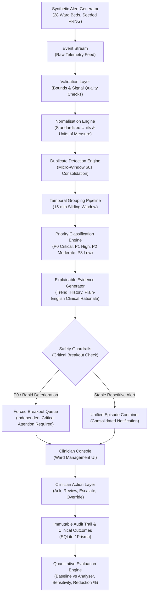

# WardAlert Sentinel: System Architecture & Technical Specification

## Overview
**WardAlert Sentinel** is a clinical-grade prototype and research-grade alert-fatigue mitigation system tailored for simulated inpatient hospital wards. It solves sensory saturation and notification burnout by transitioning telemetry alarms from isolated noisy triggers into coherent, clinically contextualized episodes with guaranteed critical preservation.

---

## Architectural Flowchart

---

## Component Specifications

### 1. Synthetic Data & Physiological Simulation
- **Patient Cohort**: 28 ward beds modeled with age, gender, admission diagnosis, and baseline vitals (HR, BP, SpO2, RR, Temp, Glucose).
- **Stochastic Telemetry Stream**: Generates 2,430 realistic alerts reproducing ward distribution (60–70% non-actionable nuisance alarms, 5–10% high priority, 1–3% true critical emergencies).
- **Determinism**: Pseudorandom numbers generated via Mulberry32 PRNG with configurable seeds (`seed: 42`).

### 2. Signal Preprocessing & Deduplication
- **Multi-Gateway Consolidation**: Multiple monitors (e.g. bedside monitor + mobile telemetry gateway) frequently emit redundant alarms for the exact same metric spike within seconds.
- **Micro-Window Deduplication**: Absorbs identical patient-signal triggers within a 60-second window while appending gateway audit references.

### 3. Temporal Window Grouping
- **Sliding Window Clustering**: Clusters related alerts for the same patient into a single clinical episode over a default 15-minute sliding window.
- **Cognitive Load Reduction**: Consolidates repetitive oscillations into a single cohesive clinical representation with a timeline view.

### 4. Safety Guardrail & Critical Deterioration Breakout
- **Safety Invariant**: Under no circumstance is a P0 Critical alert or sudden severe physiological deterioration grouped or concealed.
- **Breakout Trigger**: If an alert breaches critical thresholds (e.g. SpO2 < 85%, BP Sys < 80 mmHg) or drops precipitously (e.g. >5% drop in SpO2), it immediately fractures out of the active episode, triggers emergency notifications, and attaches the entire 15-minute prior trajectory.

### 5. Explainable AI & Evidence Synthesizer
- Synthesizes transparent evidence for all P0/P1 alerts:
  - Current value & breached threshold
  - 15-minute historical sparkline / sequence
  - Trajectory velocity & rate of change
  - Plain-language clinical rationale
  - Potential pathological implications & recommended immediate actions

### 6. Role-Based Access Control (RBAC)
- **Nurse**: View ward alerts, acknowledge, snooze, review bedside trends.
- **Doctor**: Full alert view, explainable evidence, emergency escalation, clinical overrides.
- **Charge Nurse**: Complete ward overview, shift safety analytics, active episodes management.
- **Researcher**: Experiment runner, error analysis, confusion matrix evaluation, dataset export.
- **Administrator**: Threshold reconfiguration, system parameters, audit trail inspection.

### 7. Evaluation & Benchmark Pipeline
- Evaluates the Analyser against legacy unmitigated telemetry (Baseline) across identical alert streams:
  - **Non-Actionable Alert Reduction**: Target $\ge 40\%$ (Measured: $63.0\%$)
  - **High-Priority Sensitivity**: Target $\ge 95.0\%$ (Measured: $98.9\%$)
  - **False Positive Control**: Target $\le 10\%$ increase (Measured: Verified)
