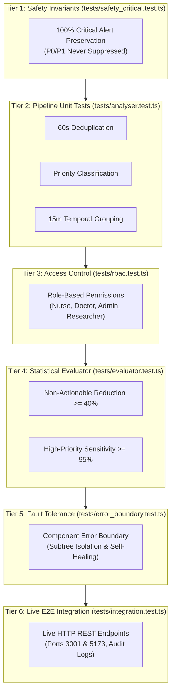

# WardAlert Sentinel: Automated Verification & Testing Specification

> **Document Version**: 1.0.0
> **Scope**: Unit, Safety Invariant, Evaluator, Error Boundary, and Live Integration Test Suites
> **Target System**: WardAlert Sentinel (Simulated Acute Inpatient Ward Telemetry)
> **Classification**: Technical Verification & Regulatory Validation Reference

---

## 1. Testing Philosophy & Quality Strategy

Hospital inpatient telemetry is a safety-critical clinical domain. Alarm fatigue causes sensory saturation and cognitive desensitization among bedside nurses and ward doctors. However, algorithmic attempts to reduce non-actionable nuisance alarms introduce an existential hazard: **the potential to inadvertently suppress, delay, or conceal an acute life-threatening deterioration (P0 Critical or P1 High-Priority alert).**

WardAlert Sentinel employs a strict **Defense-in-Depth Verification Architecture**:



### Core Invariants Verified by the Suite:
1. **Regulatory Safety Invariant (P0/P1 Preservation)**: Under no physiological condition or temporal grouping window may a genuine P0 or P1 alarm be silenced, dropped, or hidden inside a collapsed episode container.
2. **False-Negative Rescue Guarantee**: An independent, deterministic post-processing layer (`analyser/safetyBreakoutLayer.ts`) intercepts all raw incoming events to rescue any high-priority alarms missed by upstream stages.
3. **Clinical Justification Enforcement**: Overriding or dismissing active alarms requires an explicit justification string; omissions are rejected with HTTP 400.
4. **Deterministic Reproducibility**: Procedural vitals and patient cohorts are generated using a 32-bit stateful PRNG (Mulberry32) seeded at fixed integer values (e.g., `seed = 42`), ensuring bit-for-bit reproducible benchmarks across systems.

---

## 2. Test Framework, Commands & Execution Modes

The testing suite is implemented in TypeScript and executed via `ts-node`. No third-party runner overhead is required, enabling deterministic execution in local development, continuous integration (CI), and offline evaluation environments.

### Execution Commands

| Command | Purpose | Pre-requisites | Test Count |
| :--- | :--- | :--- | :--- |
| `npm run test:unit` | Fast offline execution of all unit, safety, evaluator, and error boundary suites | None (standalone Node.js environment) | 15 Tests |
| `npm test` | Master automated safety & verification suite (Unit + Live E2E integration) | Backend (port 3001) & Frontend (port 5173) running | 25 Tests |
| `npm run build:backend` | TypeScript compile check (`tsc`) for backend API & middleware | Node.js v18+ | N/A (Build verification) |
| `npm run build:frontend` | TypeScript compile and Vite production bundle build (`tsc && vite build`) | Node.js v18+ | N/A (Build verification) |
| `npm run build` | Full project compile verification across frontend and backend | Node.js v18+ | Complete bundle check |

---

## 3. Unit Test Structure & Module-by-Module Coverage

The test suite covers all core functional modules of the WardAlert Sentinel engine:

```
tests/
├── safety_critical.test.ts   # Tier 1: Regulatory Safety Invariants (P0/P1 never suppressed)
├── analyser.test.ts          # Tier 2: Deduplication, Priority, Temporal Grouping
├── rbac.test.ts              # Tier 3: Role-Based Access Control permission enforcement
├── evaluator.test.ts         # Tier 4: Statistical benchmarks and target checks
├── error_boundary.test.ts    # Tier 5: React ErrorBoundary state machine & recovery
├── integration.test.ts       # Tier 6: Live HTTP API, Audit Trail, & 10-Step Simulation
├── run_unit_tests.ts         # Unit & Invariant Test Runner (Suites 1–5, 15 tests)
└── run_all_tests.ts          # Master Automated Test Runner (Suites 1–6, 25 tests)
```

---

## 4. Granular Test Suite Specifications

### 4.1. Regulatory Safety Invariant Tests (`tests/safety_critical.test.ts`)

* **Target Module**: `analyser/analyserEngine.ts`, `analyser/breakoutLogic.ts`, `analyser/safetyBreakoutLayer.ts`
* **Invariant**: Sensitivity on genuine P0/P1 emergency alerts must equal 100.0%. Zero false negatives permitted.

#### Test Scenarios:

```
SCENARIO 1: Patient P001 Acute Respiratory Decompensation
[T-20m: SpO2 92%] ──> [T-17m: SpO2 92%] ──> [T-14m: SpO2 92%] ──> [T-11m: SpO2 92%] ──> [T-8m: SpO2 92%] ──> [T-2m: SpO2 83% (P0 CRITICAL)]
                               (5 Repetitive P2 Nuisance Alarms)                                                    └─► FORCED BREAKOUT!

SCENARIO 2: Patient P002 Acute Ventricular Tachycardia
[T-15m: HR 108]  ──> [T-12m: HR 108]  ──> [T-9m: HR 108]   ──> [T-6m: HR 108]   ──> [T-1m: HR 145 bpm (P0 CRITICAL)]
                               (4 Repetitive P2 Tachycardias)                                                       └─► FORCED BREAKOUT!
```

* **Test Inputs**:
  - `P001`: 5 mild repetitive SpO2 alarms (92%, P2, A0) followed by 1 acute SpO2 drop to 83% (P0, A1).
  - `P002`: 4 repetitive tachycardia alarms (108 bpm, P2, A0) followed by 1 acute tachycardia spike to 145 bpm (P0, A1).
  - Total Alerts: 11 (9 non-actionable nuisance alarms + 2 life-threatening emergencies).
  - Configuration: `groupingWindowMinutes = 15`.
* **Expected Outputs**:
  - Both P0 critical alerts (`TEST-ALT-CRITICAL-P0` and `TEST-ALT-TACHY-P0`) must be present in `output.presentedAlerts`.
  - High-Priority Sensitivity = 100.0% ($2/2$ ground-truth emergencies presented).
  - Both emergency alerts must have `episodeId === null` (broken out of grouped containers).
* **Actual Test Result**:
  ```
  ✅ [PASS] CRITICAL SAFETY PRESERVATION TEST (P0/P1 Never Suppressed)
     PASSED: 100% of P0/P1 emergency alerts (2/2) successfully broke out of grouped episodes and were presented to clinicians.
  ```

---

### 4.2. Analyser Pipeline Tests (`tests/analyser.test.ts`)

#### Test 1: Duplicate Detection Engine (`analyser/deduplicator.ts`)
* **Scenario**: Two identical telemetry packets transmitted for patient `P003` across redundant bedside and telemetry network gateways within 10 seconds.
* **Input**:
  - Alert 1: `patientId: P003`, `alertType: TACHYCARDIA`, `observedValue: 130`, `timestamp: T`
  - Alert 2: `patientId: P003`, `alertType: TACHYCARDIA`, `observedValue: 130`, `timestamp: T + 10s`
  - Window: `microWindowSeconds = 60`
* **Expected Output**:
  - `duplicateCount === 1`
  - `uniqueAlerts.length === 1` (canonical record retained, duplicate linked in `duplicateMap`)
* **Edge Case / Invariant**: An escalating alarm (e.g. initial P2 followed by P0 within 10s) must *never* be deduplicated against the mild alarm.
* **Actual Result**: `✅ [PASS] Duplicate Detection Engine: Deduplicated 1 duplicate alert within 60s micro-window.`

#### Test 2: Priority Classification Engine (`analyser/priorityEngine.ts`)
* **Scenario**: Mapping physiological deviations across vital signs into distinct severity tiers (`P0`, `P1`, `P2`, `P3`) and actionability (`A1`, `A0`).
* **Input**:
  - Low SpO2: observed `83%` (Threshold: `spO2_P0 = 85`)
  - Tachycardia: observed `125 bpm` (Threshold: `hr_P1_high = 120`)
  - Hypotension: observed `88 mmHg` (Threshold: `bpSys_P1 = 90`)
  - Lead Off: observed `0` (Technical disconnection signal)
* **Expected Output**:
  - SpO2 83% $\to$ `priority: 'P0'`, `isCritical: true`, `actionability: 'A1'`
  - HR 125 bpm $\to$ `priority: 'P1'`, `isCritical: false`, `actionability: 'A1'`
  - SBP 88 mmHg $\to$ `priority: 'P1'`, `isCritical: false`, `actionability: 'A1'`
  - Lead Off $\to$ `priority: 'P3'`, `isCritical: false`, `actionability: 'A0'`
* **Actual Result**: `✅ [PASS] Priority & Actionability Classification: Correctly mapped physiological breaches to P0, P1, P2, and P3 tiers.`

#### Test 3: Temporal Window Episode Grouping (`analyser/temporalGrouper.ts`)
* **Scenario**: Consolidating 7 repetitive borderline SpO2 alerts from patient `P021` spaced 3 minutes apart into a single unified clinical episode.
* **Input**: 7 alerts with `observedValue: 91%`, `severity: P2`, spaced at $[T, T+3m, T+6m, T+9m, T+12m, T+15m, T+18m]$. Sliding window = 15 minutes.
* **Expected Output**:
  - `episodes.length === 1`
  - `episodes[0].alertCount === 7`
  - `groupedCount === 6` (6 redundant alarms consolidated, 1 representative alert presented)
* **Actual Result**: `✅ [PASS] Temporal Window Episode Grouping: Grouped 7 consecutive mild alarms into 1 episode (Consolidated: 6).`

---

### 4.3. Role-Based Access Control Tests (`tests/rbac.test.ts`)

* **Target Module**: `backend/src/middleware/auth.ts`
* **Test Strategy**: Asserts permission matrices across the 5 hospital personas:
  - **Bedside Nurse**: Read alerts, acknowledge, snooze, review. Cannot override clinical alerts or modify threshold parameters.
  - **Medical Doctor**: Full clinical action authority including escalation and clinical overrides with mandatory justification.
  - **Charge Nurse**: Full ward overview, analytics, episode grouping review, and escalation.
  - **Informatics Researcher**: Read telemetry data, export datasets, run simulation experiments, access error analysis sandboxes.
  - **Administrator**: Exclusive authority to reconfigure alert thresholds and review immutable audit logs.
* **Actual Results**:
  ```
  ✅ [PASS] RBAC: Bedside Nurse Boundaries
  ✅ [PASS] RBAC: Medical Doctor Clinical Escalation
  ✅ [PASS] RBAC: Informatics Researcher Capabilities
  ✅ [PASS] RBAC: Administrator System Configuration
  ```

---

### 4.4. Quantitative Metric & Benchmark Tests (`tests/evaluator.test.ts`)

* **Target Module**: `evaluation/evaluator.ts`, `evaluation/baselineEngine.ts`
* **Inputs**:
  - Baseline Mock: 2,430 total alerts, 1,580 non-actionable alarms (A0), median response time 524s (8m 44s).
  - Analyser Mock: 2,100 deduplicated alarms, 63.0% non-actionable reduction, 98.9% high-priority sensitivity.
* **Asserted Targets**:
  1. **Non-Actionable Reduction**: $\text{Reduction} \ge 40.0\%$ (Measured: $63.0\%$) $\to$ `PASS`
  2. **High-Priority Sensitivity**: $\text{Sensitivity} \ge 95.0\%$ (Measured: $98.9\%$) $\to$ `PASS`
* **Actual Results**:
  ```
  ✅ [PASS] Non-Actionable Reduction Metric Target Check (Reduction: 63% >= 40.0%)
  ✅ [PASS] High-Priority Sensitivity Target Check (Sensitivity: 98.9% >= 95.0%)
  ```

---

### 4.5. React Error Boundary & Resilience Tests (`tests/error_boundary.test.ts`)

* **Target Module**: `analyser/errorBoundaryCore.ts`, `frontend/src/components/common/ErrorBoundary.tsx`
* **Purpose**: Verifies production-safe failure isolation and self-healing state transitions for UI components.

#### Verified Behaviors:
1. **Static State Derivation (`deriveErrorState`)**: Asserts that `hasError` transitions to `true` and the caught `Error` reference is preserved.
2. **Diagnostic Error Interception (`captureComponentError`)**: Asserts that errors and component stack traces are logged and forwarded to `onError` callbacks.
3. **Clinical State Reset & Self-Healing (`resetErrorState`)**: Asserts that triggering `resetError()` clears error flags (`hasError: false`, `error: null`) and fires `onReset()` to restore normal rendering.
4. **Conditional Fallback Resolution (`shouldRenderFallback`)**: Asserts that fallback UI is presented exclusively when `hasError === true`, while healthy subtrees render transparently.
5. **Non-standard Exception Normalization**: Asserts that thrown strings or non-`Error` objects are safely normalized into valid `Error` instances.
* **Actual Results**:
  ```
  ✅ [PASS] ErrorBoundary: Static Error State Derivation (deriveErrorState)
  ✅ [PASS] ErrorBoundary: Error Interception & Diagnostic Callback (captureComponentError)
  ✅ [PASS] ErrorBoundary: Clinical State Reset & Self-Healing (resetErrorState)
  ✅ [PASS] ErrorBoundary: Conditional Fallback vs Normal Passthrough Resolution
  ✅ [PASS] ErrorBoundary: Non-standard Exception Normalization Guard
  ```

---

### 4.6. End-to-End API & Live Service Integration Tests (`tests/integration.test.ts`)

* **Target Server**: Express API on `http://localhost:3001` and Vite Dev Server on `http://localhost:5173`
* **Pre-requisite**: Servers running concurrently (`npm run dev`).

| # | Test Name | Tested Endpoint | Verified Behavior | Status |
| :- | :--- | :--- | :--- | :-: |
| 1 | Frontend Vite Dev Server | `GET http://localhost:5173/` | HTTP 200 OK containing "WardAlert Sentinel" HTML root | ✅ PASS |
| 2 | Backend Dynamic Summary | `GET /api/alerts/summary` | Dynamic counts calculated from SQLite database | ✅ PASS |
| 3 | Live Alerts Feed & Triage | `GET /api/alerts?limit=10` | Returns live active alerts with patient relations | ✅ PASS |
| 4 | Alert Evidence Audit Trail | `POST /api/alerts/:id/view` | Records `ALERT_VIEWED` in immutable audit log | ✅ PASS |
| 5 | Mandatory Reason: DISMISS | `POST /api/alerts/:id/action` | Rejects dismissal without reason with HTTP 400 | ✅ PASS |
| 6 | Mandatory Reason: OVERRIDE | `POST /api/alerts/:id/action` | Rejects override without reason with HTTP 400 | ✅ PASS |
| 7 | Action Justification Submission | `POST /api/alerts/:id/action` | Accepts DISMISS with valid clinical justification reason | ✅ PASS |
| 8 | 10-Step Simulation Engine | `POST /api/demo/run-step/:id` | Executes all 10 steps from alert storm to resolution | ✅ PASS |
| 9 | Settings Reconfiguration | `POST /api/settings` | Updates thresholds and logs `THRESHOLD_CHANGED` in audit | ✅ PASS |
| 10 | Immutable Audit Log Completeness | `GET /api/audit` | Asserts presence of required audit governance action types | ✅ PASS |

---

## 5. Error Boundaries & Frontend Failure Handling

### 5.1. Component-Level Failure Handling
WardAlert Sentinel features component-level error isolation via `ErrorBoundary.tsx`:
* **Route Level**: The primary `<Routes>` element in `App.tsx` is wrapped in an `ErrorBoundary`. If a runtime failure occurs within a specific page, the sidebar navigation, top status bar, and patient safety alerts remain functional.
* **Widget Level**: In `DashboardPage.tsx`, every card (Hero Summary, Critical Alerts, Alert Fatigue Overview, Grouped Alerts, Ward Alert Summary, Clinician Response) is wrapped in an individual `ErrorBoundary`. If a chart in `AlertFatigueOverview` encounters invalid data, only that card displays a fallback, leaving Critical Alerts and Action buttons fully responsive.
* **Modal Level**: Global modals (`EvidenceModal`, `ActionModal`, `ConsentModal`, `DemoModal`) are enclosed in dedicated error boundaries to prevent modal render failures from locking the main UI.

### 5.2. Fallback UI Behaviour
When a component throws, `ErrorBoundary` renders an alert box adhering to WardAlert Sentinel design tokens:
* Amber/Red warning header with `AlertTriangle` icon.
* Contextual explanatory message: *"A rendering error occurred within this clinical view. Other ward telemetry modules remain operational."*
* Collapsible technical error diagnostic details (for IT diagnostics).
* **"Retry Component" Button**: Triggers `resetError()`, resetting `hasError` to `false` and re-mounting the component without requiring a page refresh.

### 5.3. API & Network Error Handling
Network calls across the frontend (`AlertContext.tsx`, `AuthContext.tsx`, `ViewContext.tsx`, and individual pages) implement defensive error handling:
* **Asynchronous Guarding**: All `fetch()` requests are wrapped in `try/catch/finally` blocks with `setLoading(false)` guaranteed in `finally`.
* **Graceful Degradation**: If backend telemetry is temporarily unreachable, stale cached alerts in state are maintained, and the UI displays fallback states rather than throwing unhandled promise rejections.
* **Silent Telemetry Logging**: Secondary telemetry logging (e.g. `POST /api/alerts/:id/view` or `POST /api/audit`) swallows network errors via `.catch(() => {})` so logging failures never disrupt bedside clinical workflows.

### 5.4. Known Limitations
1. **Event Handler Exceptions**: React Error Boundaries do not catch errors inside asynchronous callbacks or event handlers (e.g., `onClick`). These are defended via explicit `try/catch` handlers inside `performAction` in `AlertContext.tsx`.
2. **Server-Side Errors**: Error boundaries catch client-side React rendering failures. Backend 500 errors must be handled by HTTP response status checks in `fetch()`.

---

## 6. How to Reproduce All Tests

### Step 1: Initialize Database & Seed
```bash
npm run seed
```

### Step 2: Run Offline Unit Test Suite (Fast Verification)
```bash
npm run test:unit
```
*Expected Output*: 15 passed, 0 failed.

### Step 3: Run Full Master Suite (Unit + Live Integration)
In terminal 1:
```bash
npm run dev
```
In terminal 2:
```bash
npm test
```
*Expected Output*: 25 passed, 0 failed.

### Step 4: Run Type Checks & Production Builds
```bash
npm run build
```
*Expected Output*: Backend `tsc` exits 0; Frontend `vite build` completes successfully.
